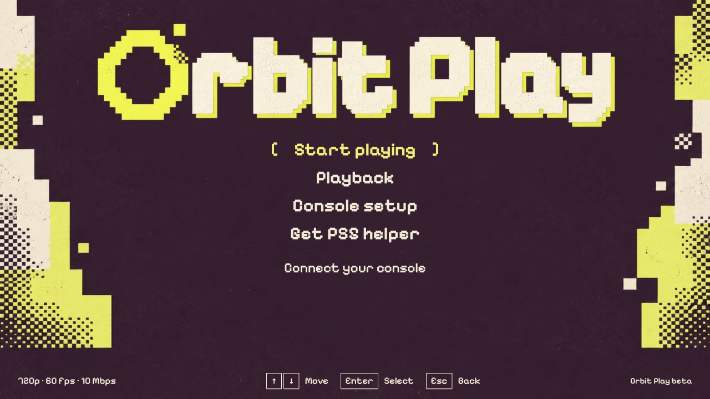
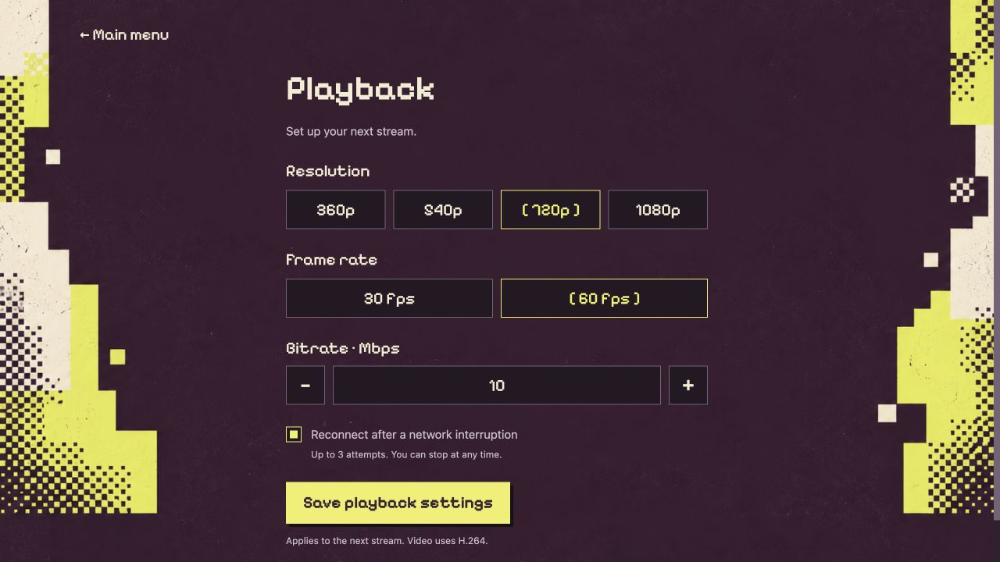

<p align="center">
  
</p>
<h1 align="center">
  Orbit Play<br>
  <sub>Beta</sub>
</h1>

<p align="center"><strong>Remote Play for your jailbroken PS5.</strong><br>
Play on your Mac, Windows or Linux computer over your local network, without PSN sign-in.</p>

[Download](https://github.com/saawant12/orbit-play-ps5/releases/latest) · [Get started](#get-started) ·
[Guides](#guides) · [Release notes](release-notes/0.2.0-beta.1.md) · [Beta status](#beta-status) · [Account setup](guides/account-setup.md) ·
[Payload Manager](#payload-manager) · [Troubleshooting](guides/troubleshooting.md) ·
[Report a bug](https://github.com/saawant12/orbit-play-ps5/issues/new?template=bug_report.md)

**Orbit Play is a Remote Play app for jailbroken PS5s**, available on Mac,
Windows and Linux. It is an alternative to Sony's PS Remote Play app for playing
over your local network without PSN sign-in or an internet connection.

## How Orbit Play is different

- **Remote Play for local PS5 accounts.** Orbit Play can enable Remote Play for
  profiles that have never been linked to PSN. If a local account ID is needed,
  it creates one after you review and confirm the changes. Read the
  [account setup and save risks](guides/account-setup.md) before continuing.
- **Automatic account-ID and PIN handling.** Orbit Play reads the selected
  profile's account ID and exchanges the Remote Play PIN for you. There is no
  manual ID lookup or conversion, and no separate PIN generator to run.
- **Setup, pairing and streaming in one app.** The computer app includes the
  streaming player and PS5 helper, and starts the helper on your PS5 for you. You
  can set up the profile, pair and play without a separate download or Chiaki app.

Load your PS5's jailbreak, enter its address in the computer app and choose
**Start helper on PS5**. Enter the six-digit trust code it shows, then pair and
play. The trust code authorizes your computer;
it is separate from the Remote Play PIN that Orbit Play handles automatically.

**Platforms:** Apple Silicon Macs, Windows PCs (including Windows 11 on ARM),
and Linux x64/arm64 computers have been tested with a PS5. Windows on ARM uses
the x64 download through emulation. Intel Macs are not supported in this beta.

> **Official source:** [saawant12/orbit-play-ps5](https://github.com/saawant12/orbit-play-ps5)
> is the only official place for Orbit Play releases, updates and support.

<p align="center">
  
  
</p>
<p align="center"><sub>Orbit Play 0.2.0-beta.1. Screenshots use example profile data.</sub></p>

## Made for playing locally

- **Pair with a code.** Trust your computer using the six-digit code shown by the PS5
  helper. Orbit Play handles the account ID and Remote Play PIN exchange.
- **Keep it on your network.** Pairing and playing happen on your home network.
  Orbit Play never needs a PSN login or an internet connection.
- **Choose your picture.** Select 360p, 540p, 720p or 1080p, 30 or 60 fps, and
  your bitrate. Start with the default 720p60 at 10 Mbps.
- **Keep users separate.** Each console address and PS5 user has its own saved
  pairing. Orbit Play checks the selected user before connecting again.
- **Recover from interruptions.** Enable up to three reconnect attempts after
  a network interruption, or press Stop to end the session.
- **Set up Remote Play when needed.** Review the changes before confirming them.
  Account setup is experimental; read the save warning if your profile needs a
  new local account ID.
- **Starts its own PS5 helper.** Choose **Start helper on PS5** in Console setup:
  Orbit Play sends the helper through Payload Manager or your ELF loader and
  starts it. To run it yourself, save it with **Get PS5 helper**.

## Beta status

**Orbit Play 0.3.0 (Beta) is prepared for release.** The helper-start instructions on this page apply to 0.3.0. See [what’s new](release-notes/0.3.0.md).

**Version 0.2.0-beta.1 is available.** [Download the app and PS5 helper](https://github.com/saawant12/orbit-play-ps5/releases/latest).
See the [release notes](release-notes/0.2.0-beta.1.md) for features, downloads and
requirements.

**This beta works on your local network only.** Your computer and PS5 must be on
the same trusted network, with the console awake and the intended user logged in.

| Device | Requirements and compatibility |
| --- | --- |
| Mac | Apple Silicon, macOS 26 or later |
| Windows | Windows 10 or 11 on x64; Windows 11 on ARM using the x64 build |
| Linux | x64 or arm64; Ubuntu 24.04 or a compatible distribution |
| PS5 | Firmware 13.60 (tested), Relapse, Payload Manager v0.5.2 |
| Network | Computer and awake PS5 on the same trusted local network |
| Console user | Logged into the user you intend to play as |

Only PS5 firmware **13.60** has been tested. On 13.60, you can pair after initial
account setup without restarting the console. Other firmware may work but is
untested; after account setup, restart the PS5 and run the jailbreak and helper
again before pairing. After restoring account settings, restart the PS5 when the
app asks, whatever the firmware.

Pairing, video and audio, keyboard controls, USB and Bluetooth DualSense controls,
reconnecting, profile switching, picture settings, and new-profile setup and
recovery have been tested on 13.60. Account setup remains experimental.

Beta Mac builds are not Apple-notarized, so macOS asks you to approve the first launch in
**System Settings → Privacy & Security → Open Anyway**. Windows builds are not
code-signed, so SmartScreen may ask you to choose **More info → Run anyway**.

## Get started

Download the **[app](https://github.com/saawant12/orbit-play-ps5/releases/latest)** for your computer. It includes the player and
the matching PS5 helper, which it starts for you.

1. **Install the app** for [Mac, Windows or Linux](guides/installation.md).
2. **Load your jailbreak** on the PS5 and open Payload Manager (or enable an ELF
   loader). Stay logged into the PS5 profile you want to play as.
3. **Start the helper.** In **Console setup**, enter the PS5's local address and
   choose **Start helper on PS5**, then enter the six-digit trust code it shows.
4. **Check the profile and pair.** Choose **Pair locally**. If Orbit Play offers
   account setup first, [review what it changes](guides/account-setup.md).
5. **Start playing.** Connect your controller to the computer, or click the video
   to use the keyboard. Press **F1** for controls.

[**Follow the screenshot walkthrough →**](guides/getting-started.md)


*Example address and code: use the values from your own PS5. The Media icon opens
the running helper; it does not start the payload.*

## Guides

| You want to… | Read this |
| --- | --- |
| Connect for the first time | [Step-by-step screenshot walkthrough](guides/getting-started.md) |
| Install, check downloads or update | [Mac, Windows and Linux installation](guides/installation.md) |
| Run the helper or use Payload Manager | [PS5 helper guide](guides/ps5-helper.md) |
| Change picture settings or learn the controls | [Playback and controls](guides/playback-and-controls.md) |
| Set up a profile or restore account settings | [Account setup and recovery](guides/account-setup.md) |
| Fix a connection or report a problem | [Troubleshooting and diagnostics](guides/troubleshooting.md) |

## Playback your way

Open **Playback** to change resolution, frame rate, bitrate and reconnect behavior.
Settings are saved for your next stream. Pressing **Stop** or closing the player
ends the session without automatically reconnecting.

Click the player to focus it. Arrow keys navigate, Enter/Space confirms and
Esc/Backspace goes back. WASD controls the left stick; IJKL controls the right
stick. Left/right mouse clicks act as confirm/back controller buttons; mouse
movement is not mapped to aiming or a PS5 pointer. Press **F1** or choose
**Controls** in the player for the full mapping. Switching away releases held
keyboard and mouse inputs. See the
[complete controls and playback guide](guides/playback-and-controls.md).



*Start at 720p, 60 fps and 10 Mbps. Save changes for the next stream.*

## Accounts and saves

**For account setup, we recommend a separate new PS5 profile with no saves.**

If your profile already has an account ID, Orbit Play keeps it. If it needs a new
local ID, the app asks you to review and accept the risk: **creating an ID may
make existing saves inaccessible**. You can choose an existing or primary profile,
but a new profile with no saves avoids risking existing saves.

**Account-settings backups do not contain games or saves.** Back up saves
separately. Restoring settings keeps an assigned ID to protect newer saves and
asks you to review the changes first. Read [account setup and recovery](guides/account-setup.md)
before using this feature.

## Payload Manager

Adding this source is optional. To download the helper from Payload Manager, [payloads.json](payloads.json) is the Orbit Play custom
repository feed. It
includes the **0.2.0-beta.1** PS5 helper.

Open **Settings → Manage Sources → Add Source** in Payload Manager and paste
this URL:

```text
https://raw.githubusercontent.com/saawant12/orbit-play-ps5/main/payloads.json
```

Choose Orbit Play, download the helper, then run it.
Use the app from the same release. The feed includes the exact helper
version and SHA-256 checksum. See [the helper guide](guides/ps5-helper.md#add-the-payload-manager-source)
for the steps.

## Questions and troubleshooting

For step-by-step fixes, use the [troubleshooting guide](guides/troubleshooting.md).

**Do I need another Remote Play tool?** No. Orbit Play includes the player and
PS5 helper, handles the account ID and Remote Play PIN, and offers account setup
when needed. You still need a jailbroken PS5 and a payload loader to run the
helper. Orbit Play does not require a PSN sign-in or provide online PSN services.

**Can I play away from home?** Not in this beta. Your computer and PS5 must be on
the same trusted local network. Wake from Rest Mode is also unavailable.

**The console is not connecting.** Keep it awake, log into the intended user,
check the local address and rerun the helper if needed. A helper restart needs
a new trust code. An IP-address change needs a new pairing.

**I switched PS5 users.** Pair that user separately and stay logged into the
same user while streaming. Orbit Play rechecks the active user before connecting.

**I reinstalled, but the old version or error is still there.** Replacing or
deleting the ELF does not stop the running helper, and Orbit Play won't start a
second copy. Stop the old helper in Payload Manager, or fully restart the PS5
(not Rest Mode) and reload the jailbreak, then choose **Start helper on PS5**.
Enter the new trust code. **Console setup → Profile & connection
options** shows both running versions and the PS5 firmware; the app blocks a
mismatched helper before account setup. If you run the helper twice, the PS5
says its port is in use and the first copy keeps running.

**Which features are unavailable?** This beta does not support HDR, microphone,
haptics, PS5 login-passcode prompts, wake from Rest Mode or account migration.
PS5 firmware other than 13.60 is untested.

We're working on support for waking the PS5 from Rest Mode, HDR, microphone
input and haptics.

**How do I report a problem?** Open an issue in this repository. Use **Export
diagnostics** in **Console setup → Profile & connection options** and include the
operating system and architecture, loader, controller connection and steps to
reproduce. The export already records the app, helper and PS5 firmware versions.
Diagnostics omit connection secrets. Review attachments before sharing; never
post trust codes, account data, pairing keys or PS5 account-settings backups.

## Licence

Orbit Play is open source. The app is licensed under the GNU Affero General
Public License, version 3 only; the PS5 helper under the GNU General Public
License, version 3 or later. Every release includes `orbit-play-<version>-source.tar.gz`
with the complete source for both components, build instructions, licences and
third-party notices.

For tools and agents, [llms.txt](llms.txt) summarises the project and
[catalogue.json](catalogue.json) describes the components, availability, tested
setup and limitations.

Orbit Play is an independent project, unaffiliated with Sony or PlayStation.
