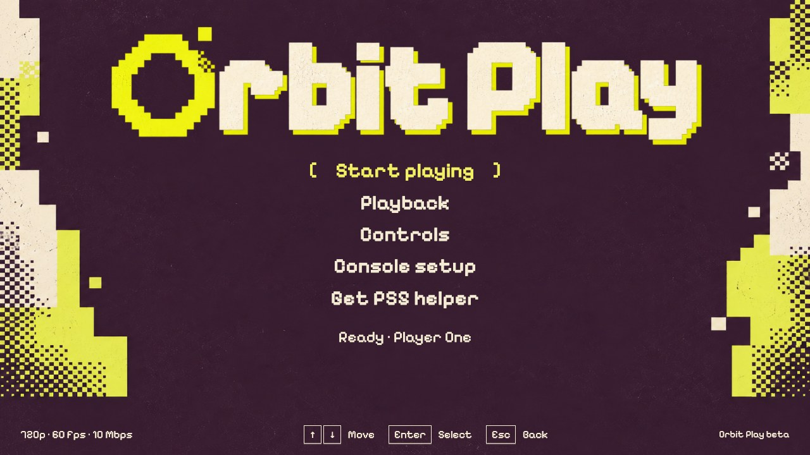
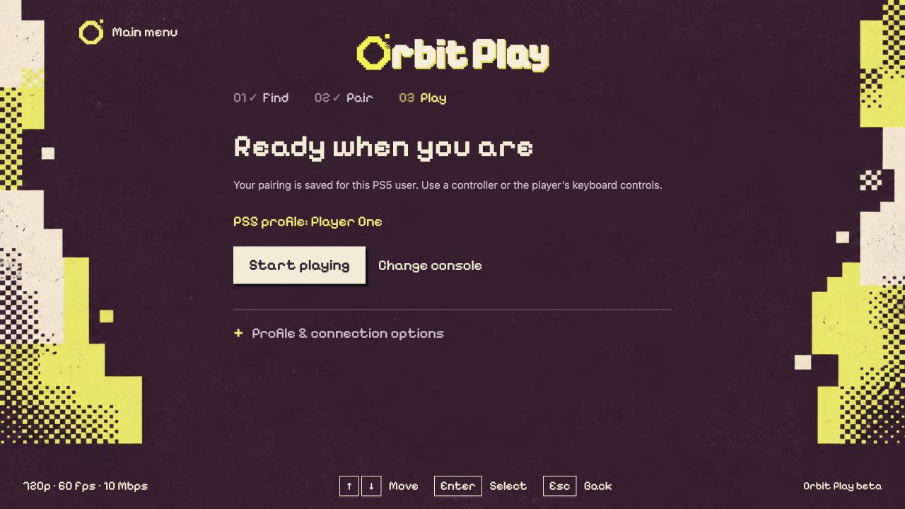
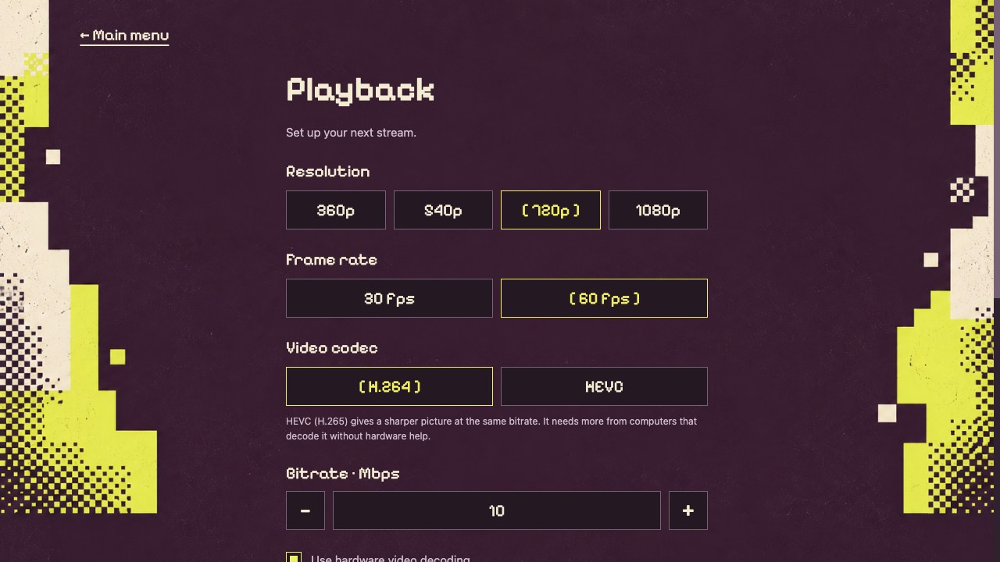

<p align="center">
  
</p>
<h1 align="center">
  Orbit Play<br>
  <sub>Beta</sub>
</h1>

<p align="center"><strong>Remote Play for your jailbroken PS5.</strong><br>
Play on your Mac, Windows or Linux computer with no PSN sign-in: at home over your local network, or away from home over the internet.</p>

<p align="center">
  <a href="https://orbitplay.dev/">Website</a> ·
  <a href="https://github.com/saawant12/orbit-play-ps5/releases/latest">Download</a> ·
  <a href="#get-started">Get started</a> ·
  <a href="guides/play-away-from-home.md">Play away from home</a> ·
  <a href="#guides">Guides</a> ·
  <a href="release-notes/0.5.0.md">Release notes</a> ·
  <a href="#beta-status">Beta status</a> ·
  <a href="guides/account-setup.md">Account setup</a> ·
  <a href="#payload-manager">Payload Manager</a> ·
  <a href="guides/troubleshooting.md">Troubleshooting</a> ·
  <a href="https://github.com/saawant12/orbit-play-ps5/issues/new?template=bug_report.md">Report a bug</a>
</p>

## How Orbit Play is different

- **Remote Play for local PS5 accounts.** Orbit Play can enable Remote Play for
  profiles that have never been linked to PSN. If a local account ID is needed,
  it creates one after you review and confirm the changes. Read the
  [account setup and save risks](guides/account-setup.md) before continuing.
- **Play away from home.** Turn it on once at home and play your PS5 from
  anywhere with an internet connection. Your computer and PS5 connect directly,
  encrypted end to end, with no account to create and no router to set up. A
  computer that has never been home can set up from anywhere with a code from
  the PS5. See [play away from home](guides/play-away-from-home.md).
- **Automatic account-ID and PIN handling.** Orbit Play reads the selected
  profile's account ID and exchanges the Remote Play PIN for you. There is no
  manual ID lookup or conversion, and no separate PIN generator to run.
- **Only download the desktop app.** The PS5 helper is built in. Choose
  **Start helper on PS5** and Orbit Play sends it to your PS5 and starts it
  through Payload Manager or your ELF loader. There's no separate ELF to
  download and no Chiaki to install: set up your profile, pair and play from the
  same app. To run the helper yourself instead, save it with **Get PS5 helper**.

> **Official source:** [saawant12/orbit-play-ps5](https://github.com/saawant12/orbit-play-ps5)
> is the only official place for Orbit Play releases, updates and support.

<p align="center">
  
  
</p>
<p align="center"><sub>Orbit Play 0.4.0 and 0.2.0-beta.1 screens. Screenshots use example profile data.</sub></p>

## Made for playing, at home or away

- **Choose your picture.** In **Playback**, select 360p, 540p, 720p or 1080p,
  30 or 60 fps, your bitrate, and H.264 or HEVC. Start with the default 720p60
  at 10 Mbps; your settings are saved for the next stream. Video decodes on
  your graphics hardware when it can. Press **F** in the player for stream
  statistics, including packet loss.
- **Feel the game.** Rumble, adaptive triggers and, over USB, DualSense haptics
  reach your controller; touchpad swipes reach the PS5.
- **Talk and play your way.** Turn on your computer's microphone with **M** or
  the DualSense mute button. Change any key under **Controls**, or aim with the
  mouse.
- **Keep users separate.** Each console address and PS5 user has its own saved
  pairing. Orbit Play checks the selected user before connecting again.
- **Recover from interruptions.** Enable up to three reconnect attempts after
  a network interruption. Pressing **Stop** or closing the player ends the
  session without reconnecting.



## Beta status

**Orbit Play 0.5.0 (Beta) is available.** [Download the desktop app](https://github.com/saawant12/orbit-play-ps5/releases/latest)
and see [what’s new](release-notes/0.5.0.md).

**Play on your local network, or away from home.** At home, your computer and PS5
must be on the same trusted network. Away from home, both need an internet
connection, after you turn it on at home or set up from anywhere with a code from
the PS5 ([guide](guides/play-away-from-home.md)).
Either way, keep the console awake and the intended user logged in.

| Device | Requirements and compatibility |
| --- | --- |
| Mac | Apple Silicon, macOS 26 or later |
| Windows | Windows 10 or 11 on x64; Windows 11 on ARM using the x64 build |
| Linux | x64 or arm64; Ubuntu 24.04 or a compatible distribution |
| PS5 | Firmware 13.60 (tested), Relapse, Payload Manager v0.5.2 |
| Network | Computer and awake PS5 on the same trusted local network; away from home, both on the internet, with no ports to open ([some networks block direct connections](guides/play-away-from-home.md#when-it-cant-connect)) |
| Console user | Logged into the user you intend to play as |

Apple Silicon Macs, Windows PCs including Windows 11 on ARM, and Linux x64 and
arm64 computers have been tested with a PS5. Play away from home has been tested
with an Apple Silicon Mac at 720p, 60 fps, H.264 and 10 Mbps with a DualSense,
including set up from anywhere and a PS5 on a phone hotspot. Intel Macs are not
supported in this beta.

Only PS5 firmware **13.60** has been tested. On 13.60, you can pair after initial
account setup without restarting the console. Other firmware may work but is
untested; after account setup, restart the PS5 and run the jailbreak and helper
again before pairing. After restoring account settings, restart the PS5 when the
app asks, whatever the firmware.

Pairing, video and audio, keyboard controls, USB and Bluetooth DualSense controls,
reconnecting, profile switching, resolution, frame-rate and bitrate settings, and
new-profile setup and recovery have been tested on 13.60. Account setup remains
experimental.

Beta Mac builds are not Apple-notarized, so macOS asks you to approve the first launch in
**System Settings → Privacy & Security → Open Anyway**. Windows builds are not
code-signed, so SmartScreen may ask you to choose **More info → Run anyway**.

## Get started

Download the **[desktop app](https://github.com/saawant12/orbit-play-ps5/releases/latest)** for your computer. It includes the player and
matching PS5 helper; you do not need to download or send the ELF yourself.

1. **Install the app** for [Mac, Windows or Linux](guides/installation.md).
2. **Load your jailbreak** on the PS5 and open Payload Manager (or enable an ELF
   loader). Stay logged into the PS5 profile you want to play as.
3. **Start the helper.** In **Console setup**, enter the PS5's local address and
   choose **Start helper on PS5**, then enter the six-digit trust code it shows.
   The code authorizes your computer; it isn't the Remote Play PIN, which Orbit
   Play handles for you.
4. **Check the profile and pair.** Choose **Pair locally**. If Orbit Play offers
   account setup first, [review what it changes](guides/account-setup.md).
5. **Start playing.** Connect your controller to the computer, or click the video
   to use the keyboard. Press **F1** for controls.

[**Follow the screenshot walkthrough →**](guides/getting-started.md)


*Example address and code: use the values from your own PS5. The Media icon opens
the running helper; it does not start the payload.*

## Guides

| You want to… | Read this |
| --- | --- |
| Connect for the first time | [Step-by-step screenshot walkthrough](guides/getting-started.md) |
| Install, check downloads or update | [Mac, Windows and Linux installation](guides/installation.md) |
| Run the helper or use Payload Manager | [PS5 helper guide](guides/ps5-helper.md) |
| Change picture settings, controller feedback, the microphone or your keys | [Playback and controls](guides/playback-and-controls.md) |
| Play from anywhere with an internet connection | [Play away from home](guides/play-away-from-home.md) |
| Set up a profile or restore account settings | [Account setup and recovery](guides/account-setup.md) |
| Fix a connection or report a problem | [Troubleshooting and diagnostics](guides/troubleshooting.md) |

## Controls

Click the player to focus it. Arrow keys navigate, Enter/Space confirms and
Esc/Backspace goes back. WASD controls the left stick; IJKL controls the right
stick. Left/right mouse clicks act as confirm/back controller buttons, and **M**
turns the microphone on or off. Press **F1** or choose **Controls** in the player
for the full mapping. Change any key, or turn on mouse aiming, under **Controls**
in the main menu. Switching away releases held keyboard and mouse inputs. See the
[complete controls and playback guide](guides/playback-and-controls.md).

## Accounts and saves

**For account setup, we recommend a separate new PS5 profile with no saves.**

If your profile already has an account ID, Orbit Play keeps it. If it needs a new
local ID, the app asks you to review and accept the risk: **creating an ID may
make existing saves inaccessible**. You can choose an existing or primary profile,
but a new profile with no saves avoids risking existing saves.

**Account-settings backups do not contain games or saves.** Back up saves
separately. Restoring settings keeps an assigned ID to protect newer saves and
asks you to review the changes first. Read [account setup and recovery](guides/account-setup.md)
before using this feature.

## Payload Manager

**Optional:** if you prefer to install and run the helper yourself, add
[payloads.json](payloads.json) as a custom source in Payload Manager. It includes
the **0.5.0** PS5 helper. You do not need to add this source when starting the
included helper from the desktop app.

Open **Settings → Manage Sources → Add Source** in Payload Manager and paste
this URL:

```text
https://raw.githubusercontent.com/saawant12/orbit-play-ps5/main/payloads.json
```

Choose Orbit Play, download the helper, then run it.
Use the app from the same release. The feed includes the exact helper
version and SHA-256 checksum. See [the helper guide](guides/ps5-helper.md#add-the-payload-manager-source)
for the steps.

## Questions and troubleshooting

For step-by-step fixes, use the [troubleshooting guide](guides/troubleshooting.md).

**Can I play away from home?** Yes. At home, turn on **Console setup → Play away
from home** once; away from home, choose **Start playing** as usual. Not at home?
Choose **Not at home? Set up from anywhere** and enter the away code and trust
code the PS5 shows under **Play away from home → Get a code**. Keep the PS5
on with the helper running: wake from Rest Mode is unavailable. See
[play away from home](guides/play-away-from-home.md).

**The console is not connecting.** Keep it awake, log into the intended user,
check the local address and rerun the helper if needed. A helper restart needs
a new trust code at home; away from home your computer keeps its access. An
IP-address change needs a new pairing. Away from home, see
[play away from home does not connect](guides/troubleshooting.md#play-away-from-home-does-not-connect).

**I switched PS5 users.** Pair that user separately and stay logged into the
same user while streaming. Orbit Play rechecks the active user before connecting.

**I reinstalled, but the old version or error is still there.** Replacing or
deleting the ELF does not stop the running helper. Orbit Play checks for a
responding helper before starting one. Stop the old helper in Payload Manager, or fully restart the PS5
(not Rest Mode) and reload the jailbreak, then choose **Start helper on PS5**.
Enter the new trust code. **Console setup → Profile & connection
options** shows both running versions and the PS5 firmware; the app blocks a
mismatched helper before account setup. If you run the helper twice, the PS5
says its port is in use and the first copy keeps running.

**Which features are unavailable?** This beta does not support HDR, wake from
Rest Mode, account migration or Intel Macs, and Orbit Play doesn't provide
online PSN services. Orbit Play's server doesn't relay streams, so networks that
block direct connections can't play away from home. PS5 firmware other than
13.60 is untested.

We're working on support for waking the PS5 from Rest Mode and HDR.

**How do I report a problem?** Open an issue in this repository. Use **Export
diagnostics** in **Console setup → Profile & connection options** and include the
operating system and architecture, loader, controller connection and steps to
reproduce. The export already records the app, helper and PS5 firmware versions.
Diagnostics omit connection secrets. Review attachments before sharing; never
post trust codes, away codes, account data, pairing keys or PS5 account-settings
backups.

## Licence

Orbit Play is open source. The app is licensed under the GNU Affero General
Public License, version 3 only ([LICENSE](LICENSE)); the PS5 helper under the GNU
General Public License, version 3 or later ([GPL-3.0-or-later](LICENSES/GPL-3.0-or-later.txt)).
Orbit Link, which plays away from home, is in the source's `link/` folder: its
engine under GPL-3.0-or-later and its server under AGPL-3.0-or-later.
Every release includes `orbit-play-<version>-source.tar.gz` with the complete
source for both components, including Orbit Link and its server, build
instructions, licences and third-party notices.

For tools and agents, [llms.txt](llms.txt) summarises the project and
[catalogue.json](catalogue.json) describes the components, availability, tested
setup and limitations.

Orbit Play is an independent project, unaffiliated with Sony or PlayStation.
