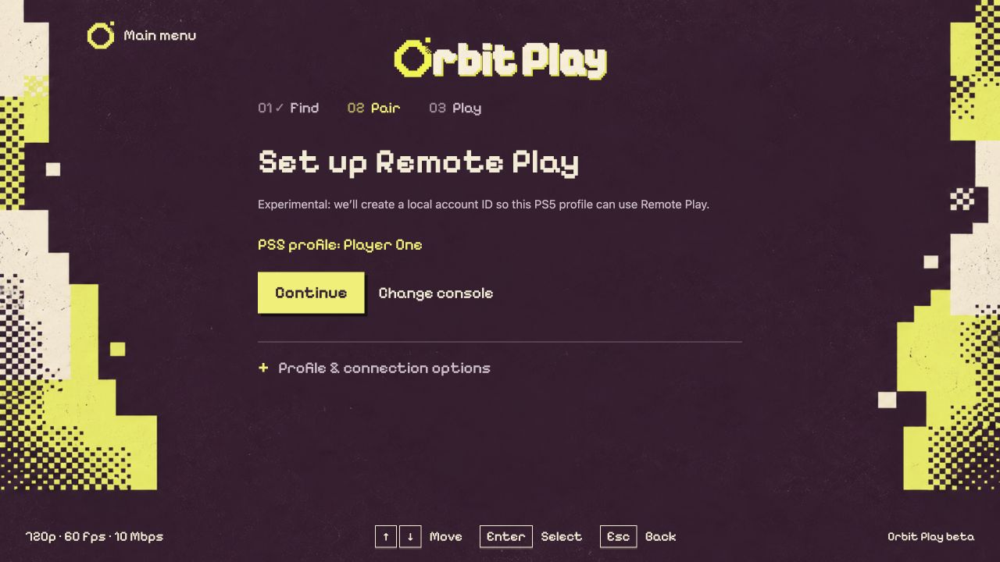
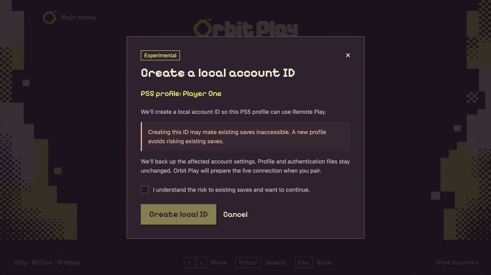
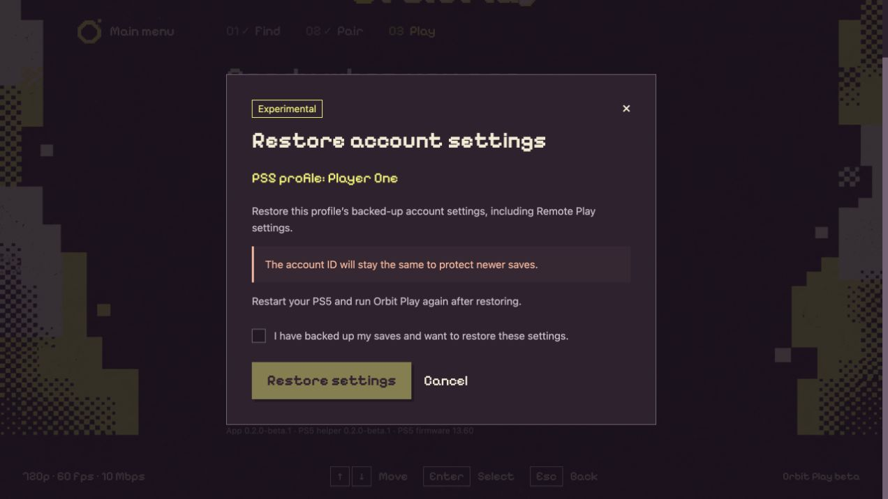

# Account setup and recovery

[All guides](../README.md#guides) · [First connection](getting-started.md) · [Troubleshooting](troubleshooting.md)

Orbit Play only offers account setup when the selected PS5 profile needs a local
account ID or needs Remote Play enabled. If the profile is already ready, you go
straight to **Pair locally** or **Start playing**. There is no separate setup
button you need to use every time.

Setup is **experimental** and has been tested with a new profile on PS5 firmware
13.60, Relapse and Payload Manager v0.5.2. Other firmware and profile configurations
may behave differently.

## What it means for your profile

| What Orbit Play finds | What you will see | What setup does |
| --- | --- | --- |
| The profile already has an account ID and Remote Play is ready | Pair locally or Start playing | No account setup is needed. |
| The profile has an account ID but Remote Play is disabled | Enable Remote Play | Reviews enabling Remote Play while keeping the existing ID. |
| The profile has no local account ID | Set up Remote Play → Continue | Reviews creating an ID and enabling Remote Play. You must accept the risk to existing saves. |
| An earlier setup was interrupted | Recover account settings | Requires a recovery review before setup or pairing continues. |

Creating a new local ID **may make existing saves on that profile inaccessible**.
**We recommend a separate new PS5 profile with no saves for account setup.** You
can choose an existing or primary profile, but check and back up its saves before
continuing.

**Back up your saves separately.** Orbit Play backs up affected account settings
and related account files, not games or saves. It does not create a new PS5 user,
migrate an account, sign into PSN or remove parental restrictions. Existing
account IDs are retained.

## Set up Remote Play

1. Stop any stream, leave the PS5 at its home screen and keep the intended
   profile logged in. Check **PS5 profile** in the app.
2. If the app shows **Set up Remote Play**, choose **Continue**. If it shows
   **Enable Remote Play**, choose that button to open its review.

*You will only see this step if the selected profile needs Remote Play setup.*

3. Read the review. If an ID will be created, it explains the risk to existing
   saves. **Cancel** returns without applying the proposed setup.
4. If you want to proceed, tick the acknowledgement and choose **Create local
   ID** or **Enable Remote Play**, as shown. Keep the same user selected while
   the operation finishes.

*Example profile. Read the warning and tick the acknowledgement to enable the confirmation button.*

5. On firmware **13.60**, continue to **Pair locally** without restarting. On
   **other firmware**, restart the PS5 after setup, reload the jailbreak and
   helper, enter the new trust code, then pair. Other firmware is untested.

Do not switch users during the review or setup. If the review expires or account
settings change, open a fresh review. Do not repeat setup to troubleshoot an
unrelated connection error; [export diagnostics](troubleshooting.md#export-diagnostics).

## Restore account settings

Use this when Orbit Play asks you to recover an interrupted setup, or when you
intend to restore the backed-up settings. It is not needed for a normal update,
helper restart or profile switch.

1. Stop the stream and log into the profile whose settings you want to restore.
2. Open **Console setup → Profile & connection options → Restore account settings**.
   If recovery is required, **Review restore** opens the same review.
3. Check the profile and read the review. An assigned account ID stays the same
   to protect newer saves. Restoring the global Remote Play setting can affect
   Remote Play for the whole console.
4. If you want to proceed, acknowledge that you have backed up your saves and
   choose **Restore settings**. Otherwise choose **Cancel**.
5. After a completed restore, follow the app's instruction to restart the PS5,
   reload the jailbreak and run the helper again.

*Example profile. Restoring account settings keeps the assigned ID and does not restore saved games.*

If account settings have changed since the backup, recovery may stop to avoid
overwriting those changes. Keep the backup and [export diagnostics](troubleshooting.md#export-diagnostics)
if this happens. A backup belongs to its original profile; do not use it for a
replacement profile or delete a user to clear an error.

## What setup changes

- Creates a local account ID only if the selected profile does not have one.
- Enables that profile for Remote Play and turns on the console's Remote Play setting.
- Keeps an existing account ID and leaves other profiles' account settings alone.
- Leaves profile and sign-in files, age settings and parental restrictions unchanged.

The helper saves a backup on the PS5 before applying the reviewed changes. If
setup is interrupted, follow **Restore account settings** before trying again.
Keep the backup private; it contains account information and does not include
saved games.
