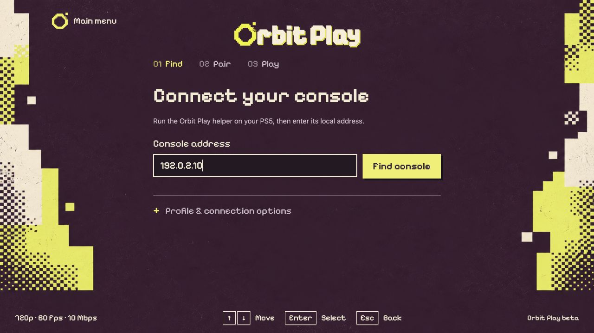
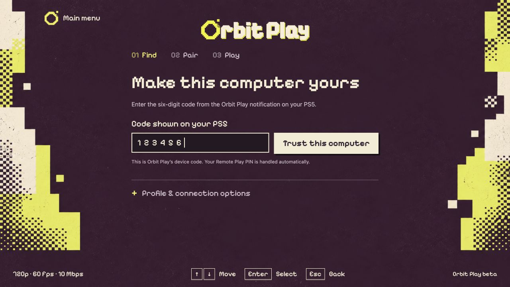
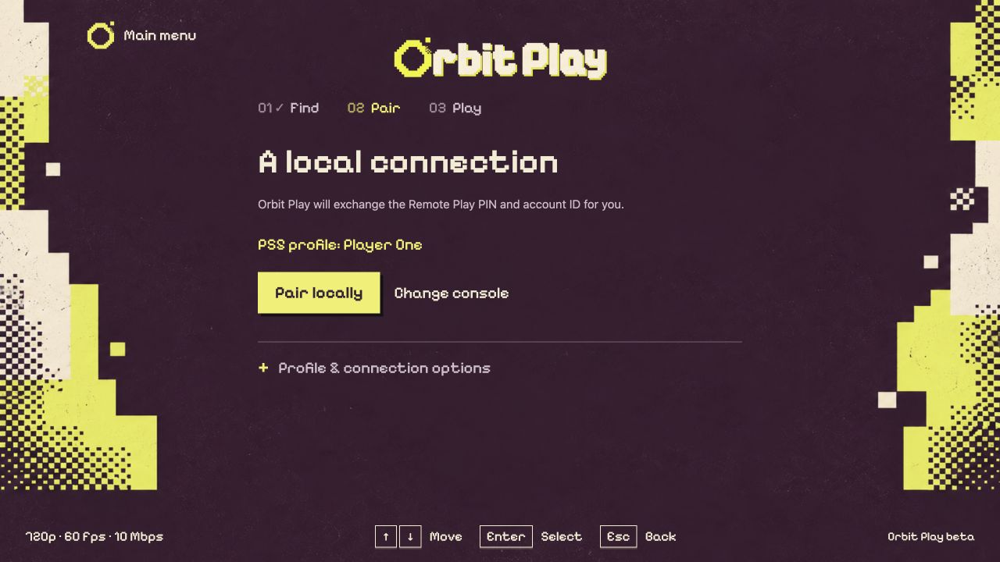

# Get started with Orbit Play

[All guides](../README.md#guides) · [Install the app](installation.md) · [Troubleshooting](troubleshooting.md)

This walkthrough takes you from starting the helper on your PS5 to your first
stream. You don't need a separate Chiaki app, a PSN sign-in, an account ID to
copy by hand or a tool to generate the Remote Play PIN.

> See [download availability and requirements](../README.md#beta-status) before
> installing. This beta connects over the same local network only.

## Before you start

If account setup is needed, **we recommend a separate new PS5 profile with no
saves**. Creating a new local account ID may make existing saves on that profile
inaccessible. Read [account setup and recovery](account-setup.md) before continuing.

- Download and install just the [desktop app](installation.md). It includes the
  PS5 helper and starts it for you; a separate ELF download is not needed.
- Keep the computer and PS5 on the same trusted local network. Keep the PS5 awake.
- Load your jailbreak, open Payload Manager (or enable an ELF loader) and log
  into the PS5 profile you want to play as.
- Connect a controller to your computer if you want to use one. Keyboard controls
  are also available.

Screenshots show **0.2.0-beta.1** with example profile data. Use the address and
code shown on **your PS5** when following the steps.

## 1. Open Orbit Play on your computer

Choose **Console setup**. **Start playing** also takes you to setup when you
have not connected a console yet.

*Console setup starts the connection flow. Playback changes the next stream's picture settings.*

## 2. Start the helper on your PS5

In **Console address**, enter your PS5's IP address, then choose **Start helper
on PS5**. Orbit Play sends its helper through Payload Manager, or an ELF loader
if Payload Manager isn't running, and starts it. The PS5 then shows a
notification with its address and a six-digit trust code, and Orbit Play moves on
to [step 4](#4-trust-this-computer).

You can find the PS5's IP address in **Settings → Network → Connection Status**
on the PS5. If the notification has disappeared, open the **Orbit Play** icon in
the PS5 **Media** row while the helper is running. See [the helper guide](ps5-helper.md)
if you prefer to run the helper yourself.

*Sample data: use your console's address and current trust code. The Media icon opens the helper screen; it does not start the payload.*

## 3. Find your console

If the helper is already running, or you started it yourself, enter the address
it shows and choose **Find console** instead. Enter only the address, without
`http://` or a port number.

*Find console checks the running helper. If the app reports a version mismatch, install the latest desktop app, stop the old helper and start the included helper.*

## 4. Trust this computer

Enter the six-digit code currently shown by the helper, then choose **Trust this
computer**. This step may be skipped when the running helper already trusts
this computer.

*This is Orbit Play's trust code. You do not need to retrieve or type the PS5's Remote Play PIN.*

## 5. Check the profile and pair

Make sure **PS5 profile** names the user you want to play as. Choose **Pair locally**
and keep that user logged in while pairing finishes.

*Orbit Play exchanges the Remote Play PIN and account ID for the displayed profile.*

If you see **Set up Remote Play** or **Enable Remote Play** instead, the profile
needs setup first. Follow [account setup](account-setup.md), read the proposed
changes, then return to pairing. Setup is experimental. Creating a new local ID
can affect access to existing saves; it requires your explicit confirmation.
Profiles that are already ready skip this step.

If the wrong profile appears, stop here. Log into the intended user on the PS5,
choose **Change console**, and find the console again. Each user is paired
separately.

## 6. Start playing

When you see **Ready when you are**, choose **Start playing**. The player opens
in a separate window. Click the video to give it keyboard focus.

*Your pairing is saved. Choose Start playing to open the player.*

Use **arrow keys** for menus, **Enter** to confirm and **Esc/Backspace** to go
back. Press **F1** in the player for the complete controls. See
[playback and controls](playback-and-controls.md) for controllers, picture
settings, stopping and reconnecting.

## Next time you play

Keep the PS5 awake, the helper running and the same profile logged in. Open
Orbit Play and choose **Start playing**; use **Console setup** if it needs to
find or trust the console again. Saved pairings are kept for each console
address and PS5 profile.

After a PS5 reboot, reload the jailbreak and choose **Start helper on PS5**
again. A helper restart changes the trust code, so enter the new one when asked. If your PS5's IP address
changes, find the new address and pair again.

**Next:** [Playback and controls](playback-and-controls.md) ·
[Switch profiles or recover a connection](troubleshooting.md)
