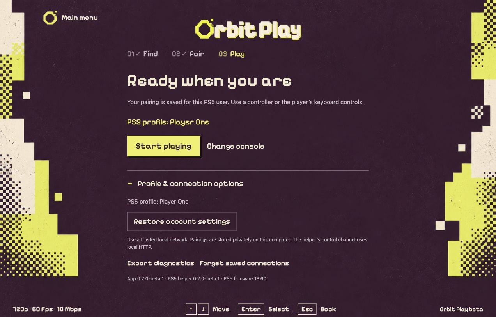

# Install and update Orbit Play

[All guides](../README.md#guides) · [First connection](getting-started.md) · [PS5 helper](ps5-helper.md)

Download the computer app and PS5 helper from the **same release**.
The app includes its streaming engine, libraries and a copy of that helper.
Python, Homebrew and a separate Chiaki-ng installation are not required.

> [Download the latest Orbit Play release](https://github.com/saawant12/orbit-play-ps5/releases/latest)
> and check the [requirements](../README.md#beta-status). Follow the install notes
> included with your release.

## Choose your download

| Computer | Download | Beta requirement |
| --- | --- | --- |
| Mac with Apple Silicon | `OrbitPlay-<version>-macos-arm64.dmg` | macOS 26 or later |
| Windows PC (x64) | `OrbitPlay-<version>-windows-x64.zip` | Windows 10 or 11 |
| Windows on ARM | `OrbitPlay-<version>-windows-x64.zip` | Windows 11; runs through x64 emulation |
| Linux PC | `OrbitPlay-<version>-linux-x64.AppImage` | x64; Ubuntu 24.04 or a compatible distribution |
| Linux on ARM | `OrbitPlay-<version>-linux-arm64.AppImage` | arm64; Ubuntu 24.04 or a compatible distribution |
| PS5 | `orbit-play-<version>-ps5.elf` | Tested on 13.60 with Relapse and Payload Manager v0.5.2 |

Intel Macs and macOS versions before 26 are not supported in this beta.
Other PS5 firmware is untested; see
[the compatibility notes](../README.md#beta-status).

## macOS

1. Quit any running copy of Orbit Play.
2. Open the DMG and drag **Orbit Play.app** to **Applications**.
3. Open Orbit Play from Applications, then eject the disk image.
4. Continue with [your first connection](getting-started.md).

This beta is **not Apple-notarized**. If macOS blocks the
first launch and you trust the release you downloaded, dismiss the warning,
open **System Settings → Privacy & Security**, find the Orbit Play warning and
choose **Open Anyway**, then confirm **Open**. A managed Mac may restrict this
approval. See the included `INSTALL-macos.txt` for the release's instructions.

## Windows

**Windows 11 on ARM has also been tested with a PS5.** Use the same
`windows-x64.zip` download. Windows runs it through its built-in
[x64 emulation](https://learn.microsoft.com/en-us/windows/arm/apps-on-arm-x86-emulation),
with no extra setup required. The download is an x64 build; Windows on ARM
requires Windows 11.

1. Extract the **whole ZIP** to a folder you will keep.
2. Open **OrbitPlay.exe** inside the extracted Orbit Play folder. Keep its
   supporting files beside it; do not run it from inside the ZIP.
3. If SmartScreen warns about the unsigned app and you trust the download,
   choose **More info → Run anyway**.
4. If Windows Firewall asks, allow Orbit Play on your **private network** so it
   can reach the PS5. Continue with [your first connection](getting-started.md).

## Linux

Download the AppImage matching your computer's architecture. In a terminal in
the download folder, replace `<version>` with the version in the filename:

```sh
chmod +x OrbitPlay-<version>-linux-x64.AppImage
./OrbitPlay-<version>-linux-x64.AppImage
```

For ARM Linux, use `linux-arm64` in both commands. If the AppImage reports a
FUSE error, use its extraction mode:

```sh
./OrbitPlay-<version>-linux-x64.AppImage --appimage-extract-and-run
```

Then follow [your first connection](getting-started.md). The app still needs a
working desktop session, audio and controller access on your Linux system.

## Check your downloads

Download `SHA256SUMS` from the same release. Calculate the SHA-256 hash of each
file you plan to use and compare it with that file's entry in `SHA256SUMS`.
Replace `FILE` below with the exact filename, including its extension:

| System | Command |
| --- | --- |
| macOS Terminal | `shasum -a 256 "FILE"` |
| Windows PowerShell | `Get-FileHash -LiteralPath "FILE" -Algorithm SHA256` |
| Linux terminal | `sha256sum "FILE"` |

All 64 characters must match; letter case does not matter. Check the PS5 ELF as
well as the app download. A mismatch means you should download that file again
before running it. A match only proves the file is the one published here, so
download the file and `SHA256SUMS` from this repository's release page.

## Update the app and helper together

1. Stop the stream and quit Orbit Play.
2. Download and check both components from the new release.
3. On **Mac**, replace the app in Applications. On **Windows**, extract the new
   ZIP into a fresh folder and use that copy. On **Linux**, make the new AppImage
   executable and launch it.
4. Stop the old PS5 helper before running the new ELF. Replacing the file does
   not replace a running process. If you cannot stop that instance through your
   loader, fully restart the PS5, reload the jailbreak and run the new helper.
5. Open **Console setup**, find the console and enter the new trust code. Check
   the app and running helper versions in **Profile & connection options**.

Saved connections and playback settings are stored separately from the computer
app, so replacing the app keeps them. Do not choose
**Forget saved connections** just to update.



*Sample profile. The version line identifies the helper that is actually running, not just the ELF stored on the PS5.*

## Other files in a release

| File | Purpose |
| --- | --- |
| `INSTALL-macos.txt`, `INSTALL-windows.txt`, `INSTALL-linux.txt` | Instructions for that release |
| `orbit-play-<version>-source.tar.gz` | Matching project source, build instructions, licences and notices for both components |
| `orbit-play-<version>-third-party-source.tar` | Source for the GPL, LGPL and AGPL libraries shipped in the apps |
| `release.json` | Build and release details |
| `SHA256SUMS` | Checksums for the release files |

**Next:** [Connect and pair](getting-started.md) · [Start the PS5 helper](ps5-helper.md)
