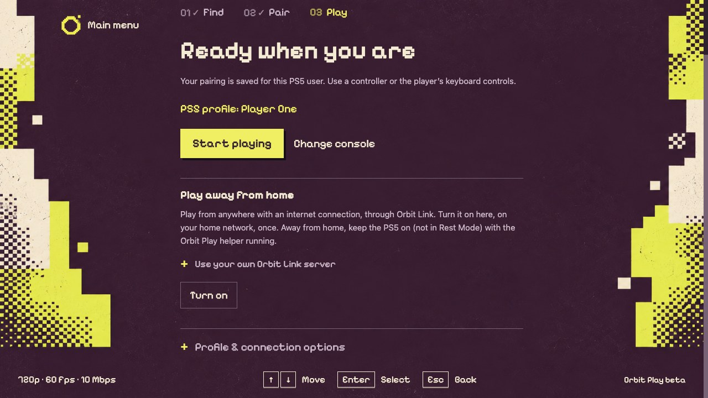
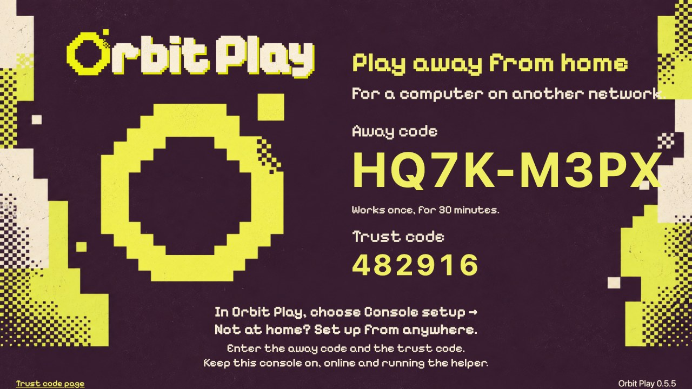
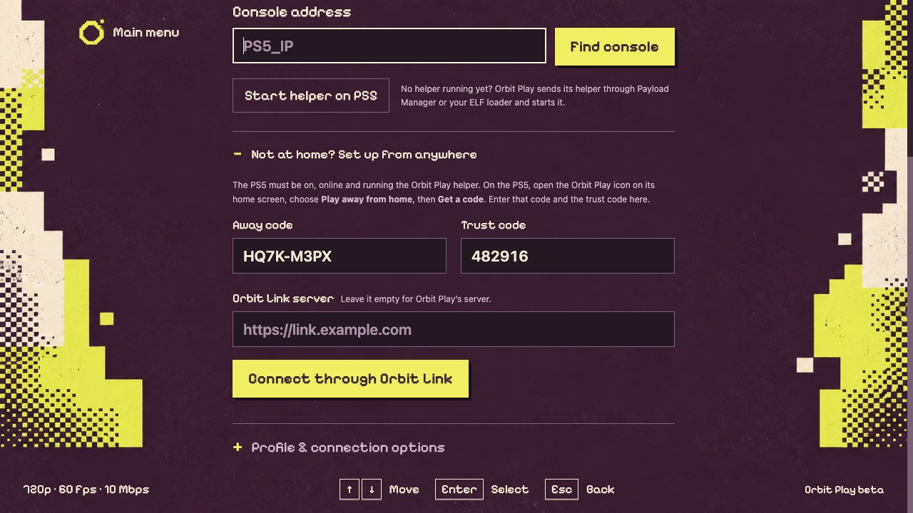
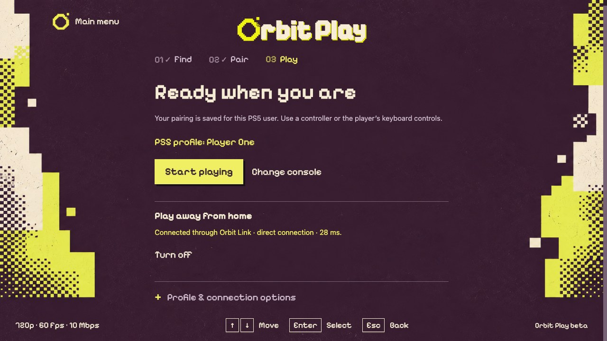

# Play away from home

[All guides](../README.md#guides) · [Get started](getting-started.md) · [Troubleshooting](troubleshooting.md#play-away-from-home-does-not-connect)

Orbit Play can reach your PS5 from anywhere with an internet connection: a
friend's place, a hotel, your phone's hotspot. You turn it on once at home; after
that, **Start playing** works the same away from home, with the pairing, playback
settings and controls you already have. A computer that has never been home can
[set up from anywhere](#set-up-from-anywhere) with a code from the PS5.

## How it works

Orbit Play uses **Orbit Link**, built into the Orbit Play helper on your PS5 and
into the desktop app. Your computer and PS5 connect **directly to each other**,
encrypted end to end, through both home routers. Orbit Play's server
(`link.orbitplay.dev`) only introduces them; your stream never passes through it.
There is no account to create and no port to open on your router.

## Turn it on at home

1. At home, with your computer on the same network as the PS5, connect and
   pair as usual ([get started](getting-started.md)).
2. Open **Console setup**. Under **Play away from home**, choose **Turn on**.
3. Orbit Play sets it up on the PS5, adds your computer and connects them. The
   PS5 shows a notification when it's connected.

When it's on, the section shows how your computer reaches the PS5, for example
**direct connection · 28 ms**.

To use your own server instead of Orbit Play's, open **Use your own
Orbit Link server** before choosing **Turn on**, and enter its **Server address**
and, if it gives codes for new devices, a **Code from your server** from its
dashboard. See
[running your own server](#run-your-own-server).

## Set up from anywhere

A computer that isn't on your home network can set itself up with a code from
the PS5, if someone at home can use the console:

1. On the PS5, open the **Orbit Play** icon in the **Media** row of the home
   screen, choose **Play away from home**, then **Get a code**. The PS5 shows an
   **away code** and its trust code. The away code works once, for 30 minutes.
   Getting a code also turns on play away from home on the PS5.
2. In Orbit Play on the computer, open **Console setup**, then **Not at home? Set
   up from anywhere**. Enter the away code and the trust code, and choose
   **Connect through Orbit Link**.
3. Orbit Play joins the PS5's network, trusts the PS5 and learns its home
   address. Pair and play as usual: pairing works away from home too.

*Example codes. Use the ones your PS5 shows.*

With your own server, the PS5's page uses the server the PS5 is set up
with; enter the same server's address under **Orbit Link server**.

## Play away from home

Open Orbit Play and choose **Start playing**, or **Find console** with your PS5's
usual address. When your home address doesn't answer, Orbit Play connects
over the internet instead; the main menu shows **Away from home**.

Before you leave, make sure the PS5 stays ready:

- **On, not in Rest Mode,** and connected to the internet.
- **Jailbreak loaded and the Orbit Play helper running.** Payload Manager's
  autostart starts the helper whenever the jailbreak loads. A full PS5 restart
  (a power cut, an update) needs the jailbreak loaded again at the console, which
  you can't do from away.
- The helper can restart while you're away: your computer keeps its access.

## Picture and data

Your home internet's **upload** speed carries the stream, and distance adds
delay. Press **F** in the player to see the packet loss: the share of the stream
lost on the way over about the last two seconds. If the picture stutters or the
packet loss stays above zero, lower the bitrate under **Playback**. At the
default 10 Mbps, an hour of play uses up to about 4.5 GB, which matters on a
phone hotspot or a metered connection.

## When it can't connect

Some routers give each connection a different port, as phone hotspots often do;
connecting through them can take up to about half a minute. Some networks still
block direct connections between devices, such as some hotel, school and office
networks, especially when both ends are strict. Orbit Play's server doesn't
relay streams, so Orbit Play then says **"Orbit Link sees your PS5 but could not
connect to it directly."** Try another network or a phone hotspot, or turn on
**UPnP** on your home router, which helps most connections. We're working on
making this better. See
[troubleshooting](troubleshooting.md#play-away-from-home-does-not-connect).

## Turn it off

At home, choose **Turn off** under **Play away from home**. That turns it off for
both the PS5 and your computer and ends your computer's access from away.
Away from home, **Turn off** removes only your computer. **Forget saved
connections** also removes your computer.

## Privacy and security

- Your stream is encrypted end to end and goes straight between your devices.
- Orbit Play's server knows your devices' names, their public internet and
  local network addresses, and how they're connected to each other, so it can
  introduce them. Nothing about your games or PS5 account is sent.
- Only devices your PS5 adds can join its network. Your computer's away-from-home
  access works only over its away-from-home connection, never from your home
  network.

## Run your own server

Orbit Link's server is open source, in the source archive attached to each
[release](https://github.com/saawant12/orbit-play-ps5/releases) (the `link/`
folder). It runs on any machine with Docker and one open UDP port, and can be
set to relay streams when a direct connection isn't possible. Its README explains the setup.
