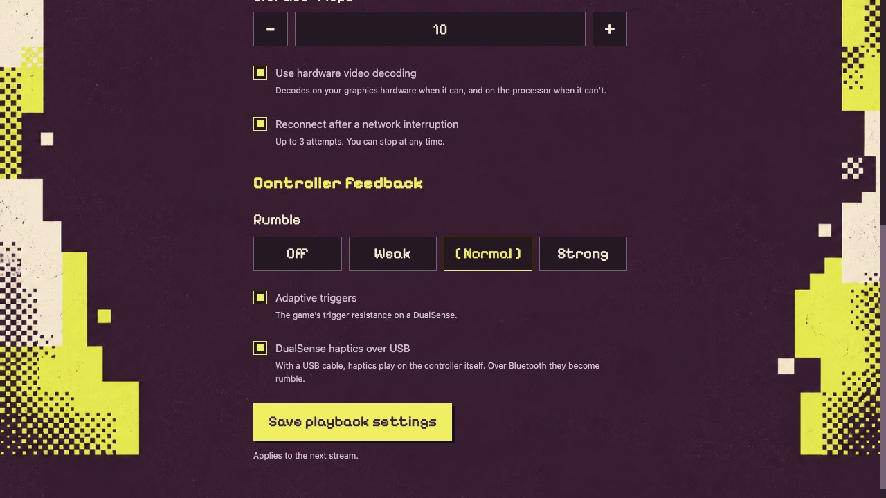
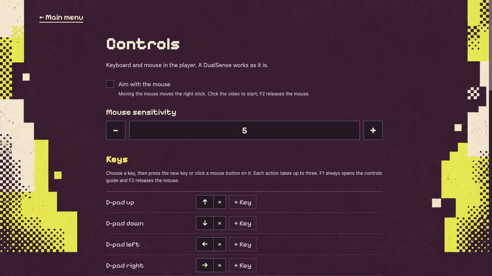

# Playback and controls

[All guides](../README.md#guides) · [First connection](getting-started.md) · [Troubleshooting](troubleshooting.md)

Choose **Start playing** after pairing. The stream opens in its own player window.
On a Mac that window belongs to its own app, **Orbit Play Player**, apart from
the main Orbit Play window.
Connect your controller to the computer or click the video to use the keyboard.

## Choose your picture settings

Open **Playback** from the main menu, choose your settings and select **Save
playback settings**. They apply to the **next stream**. If you are already
playing, stop first, save the changes and start again.

*Start with the default 720p at 60 fps, H.264 and 10 Mbps. Save changes before starting your next stream.*

| Setting | Choices | How to choose |
| --- | --- | --- |
| Resolution | 360p, 540p, 720p, 1080p | Start at 720p. Try 1080p for a sharper picture; reduce it if playback is unstable. |
| Frame rate | 30 or 60 fps | 60 fps gives smoother movement; 30 fps halves the work for the PS5, the network and your computer. |
| Video codec | H.264 or HEVC | H.264 is the default. HEVC (H.265) gives a sharper picture at the same bitrate; it suits computers that decode it in hardware. |
| Bitrate | 1–50 Mbps in 0.5 Mbps steps | Start at 10 Mbps. A higher value uses more network capacity; lower it if the network struggles. |
| Hardware video decoding | On or off | Leave it on. Orbit Play decodes on your graphics hardware when it can and on the processor when it can't. Turn it off only if the picture shows glitches. |
| Picture | Fit, Fill or Stretch | How the picture fills a window or screen of another shape; see [fit, fill or stretch](#fit-fill-or-stretch). |
| PS5 sound | On or off | Whether the PS5's sound plays on this computer; see [PS5 sound](#ps5-sound). |
| Type on the PS5 | On or off | Type the text the PS5 asks for with this computer's keyboard; see [type on the PS5](#type-on-the-ps5). |
| Reconnect | On or off | When on, Orbit Play can make up to three attempts after a network interruption. |

Hardware decoding uses VideoToolbox on a Mac, D3D11VA on Windows and Vulkan on
Linux. Press **F** in the player for the stream statistics: the frame rate, the
packet loss over about the last two seconds, the codec and whether decoding uses
the hardware. Picture quality also depends on the game, the computer and the local
connection or, away from home, your home upload speed. Change one setting at a time so you can judge the difference.

## Full screen

Choose **Full screen** in the player bar or press **F11** (**Ctrl+Cmd+F** on a
Mac) to fill the screen, and press it again to return to the window. The player
bar hides while the stream fills the screen; its keys keep working. On a Mac, the
window's green button works too.

While the player is open, your computer and its screen stay awake, even when you
play with only a controller.

## Fit, fill or stretch

When the window or screen is a different shape from the picture, such as a
16:10 laptop screen, choose how the picture fills it under **Playback → Picture**:

- **Fit** shows all of the picture, with black bars where it doesn't reach.
- **Fill** fills the window and crops the picture's edges.
- **Stretch** fills the window and stretches the picture to its shape.

Press **B** in the player to switch between them during a stream; the player
shows the one you chose. The next stream starts with the one under **Playback**.

## PS5 sound

Press **N** or choose **Sound** in the player bar to stop playing the PS5's sound
on your computer, for example while you listen on the TV, and again to bring it
back. To start every stream without it, turn off **Play the PS5's sound on this
computer** under **Playback**.

## Use a controller

Connect a DualSense to the **computer** through USB or Bluetooth. Both connection
methods have been tested on the 13.60 setup. You can connect it before or during
the stream: the player finds a controller within a second, and finds it again if
its connection drops. With more than one controller connected, it uses the
DualSense. Other controllers are untested. The sticks, motion sensors and
touchpad swipes reach the PS5 as well as the buttons, and the DualSense mute
button turns the [microphone](#use-the-microphone) on and off.

Keep the PS5 logged into the profile shown in Orbit Play. If you want another
profile, stop the stream and [switch profiles](troubleshooting.md#switch-ps5-profiles)
before reconnecting.

### Someone else playing on the PS5

You can keep streaming while someone plays at the console, for example to watch
on your computer or share the stream. Start the stream first; then they log in
on the PS5 with their own profile and a controller connected to the PS5. Orbit
Play keeps your stream going while your profile stays logged in, as the PS5's
own Remote Play does.

### Rumble, triggers and haptics

Under **Playback → Controller feedback**:

| Setting | Choices | What it does |
| --- | --- | --- |
| Rumble | Off, Weak, Normal, Strong | How strongly the controller rumbles. Normal is the default. |
| Adaptive triggers | On or off | The game's trigger resistance on a DualSense. |
| DualSense haptics over USB | On or off | With a USB cable, haptics play on the DualSense itself. Over Bluetooth, or with this off, they become rumble. |

Your PS5's own vibration and trigger-effect settings still apply. **On a Mac**,
haptics over USB need the DualSense's audio device set to 4 channels: open
**Audio MIDI Setup** (Applications → Utilities), select the DualSense, choose
**Configure Speakers** and pick **Quadraphonic**. Otherwise haptics play as rumble.

## Use the microphone

Press **M**, choose **Mic** in the player bar, or press the DualSense mute button
to turn the microphone on or off. It starts muted in every stream and uses your
computer's default input; choose a different one in your computer's sound
settings before you start the stream. On a Mac, macOS asks for microphone access
the first time. Orbit Play doesn't cancel echo, so use headphones or a headset
if the game's sound plays through speakers.

## Keyboard and mouse

Click inside the video window first. **F1** or **Controls** opens the in-player
guide, which shows your current keys. In that guide, choose **Back to game** or
press **Esc** to return. These are the default keys:

| Computer input | PS5 control |
| --- | --- |
| Arrow keys | D-pad / menus |
| W, A, S, D | Left stick |
| I, J, K, L | Right stick / look |
| Enter or Space | Cross / confirm |
| Esc or Backspace | Circle / back |
| Z / X | Square / Triangle |
| Q / E | L1 / R1 |
| 1 / 3 | L2 / R2 |
| C / V | L3 / R3 |
| O / R | Options / Create |
| P / Tab | PS button / touchpad click |
| Left / right mouse click | Cross / Circle |
| Middle mouse click | Touchpad click |
| M | Microphone on/off |
| N | PS5 sound on/off |
| B | Picture: fit, fill or stretch |
| F | Stream statistics |
| F1 | Controls guide |
| F2 | Release the mouse when aiming |
| F11 (Ctrl+Cmd+F on a Mac) | Full screen |

Switching focus away from the player releases held keyboard and mouse inputs.

### Type on the PS5

When the PS5 asks for text, such as a search or a name, a **Type on the PS5**
box opens in the player instead of the PS5's own keyboard. Type with your
computer's keyboard: the text appears on the PS5 as you type. Press **Enter** to
send it. **Esc** switches to the PS5's own keyboard and keeps what you typed, for
example to finish with the controller. While the box is open, keys type into it
instead of playing their actions. To use the PS5's own keyboard instead, turn off **Type on
the PS5 with this computer's keyboard** under **Playback**; it applies to the
next stream.

### Change your keys

Open **Controls** from the main menu. Choose a key next to an action, then press
the new key or click a mouse button on it. Each action takes up to three keys or
mouse buttons, and choosing a key that another action uses moves it. Select
**Save controls**; the new keys apply to the next stream. **Reset to defaults**
brings back the table above. F1 and F2 can't be changed. If you give F11 to an
action, press **Alt+Enter** for full screen instead.

### Aim with the mouse

Turn on **Aim with the mouse** under **Controls**. In the player, click the video
to start: the pointer disappears and moving the mouse moves the right stick, and
moving it faster turns further. Press **F2** to release the mouse, or switch to
another window. **Mouse sensitivity** (1–10) sets how fast a movement turns
fully. On Linux under Wayland, the player opens through XWayland so it can keep
the pointer in place.

## Stop and reconnect

Choose **Stop playing** from the main menu, **Stop** in the connection screen,
or close the player window to end the stream. An intentional stop does not
trigger automatic reconnect. Pressing Esc while playing sends Circle to the
PS5; it is not the stop-stream shortcut.

For a network interruption, reconnect checks the selected PS5 user before each
attempt. If the stream does not return, keep both devices awake, confirm that
the helper is running and use **Start playing** again. If the PS5 restarted,
reload the jailbreak and helper first. Reconnect does not wake a sleeping console
or switch profiles.

## If something feels wrong

- **No keyboard input:** click the video window, then try an arrow key and Enter.
- **Controller not detected:** check the controller connection in your
  computer's settings. The player picks up the controller within a second once
  your computer sees it.
- **An input stays held:** stop the stream and reconnect the controller before
  starting again. Export diagnostics if it repeats.
- **No haptics on a Mac:** set the DualSense to 4 channels in Audio MIDI Setup as
  described [above](#rumble-triggers-and-haptics), and connect it by USB.
- **The microphone doesn't turn on:** allow Orbit Play under your computer's
  microphone privacy settings and check its default input device.
- **Stutter or breakup:** stop, lower the bitrate or resolution in Playback,
  save, and retry. If you chose HEVC, try H.264. Check the local connection as
  well as picture settings. Press **F**: packet loss above zero means the
  network is dropping part of the stream.

For repeated failures, follow [troubleshooting](troubleshooting.md#export-diagnostics).
