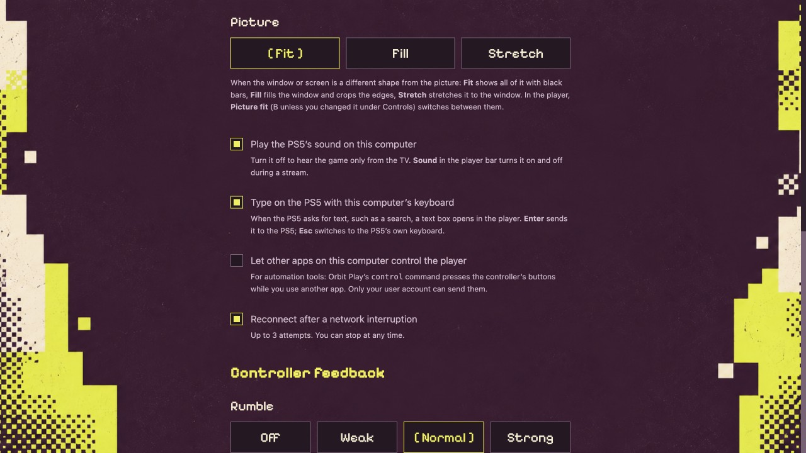

# Control the player from other apps

[All guides](../README.md#guides) · [Playback and controls](playback-and-controls.md) · [Troubleshooting](troubleshooting.md)

From 0.7.0, scripts, automation tools and AI agents on your computer can press
the controller's buttons and move its sticks on the stream, while you keep
using another app. An agent can, for example, find its way around the PS5's
menus or test a game, and take a picture of the stream window to see what
happened. The player window doesn't need to be in front. This works on a Mac,
on Linux and, from 0.8.0, on Windows.

Only your own user account on this computer can send these commands. Nothing
reaches the PS5 from another computer, and the commands you send are never
saved.

## Turn it on

1. Open **Playback** from the main menu, tick **Let other apps on this computer
   control the player**, and choose **Save playback settings**. It's off until
   you turn it on.
2. Start a stream. The player reads this setting when a stream starts, so stop
   and start again if a stream was already open.



## The command

Orbit Play itself is the command: run it with `control` first. No other
install is needed.

| Computer | Command |
| --- | --- |
| Mac | `"/Applications/Orbit Play.app/Contents/MacOS/OrbitPlay" control` |
| Windows | `& "$env:LOCALAPPDATA\Programs\Orbit Play\Orbit Play\OrbitPlay.exe" control` in PowerShell (installed with the setup program; from the ZIP, use `OrbitPlay.exe` in its folder) |
| Linux | `/path/to/OrbitPlay-0.8.0-linux-x64.AppImage control` (or the arm64 AppImage) |

The examples below call it `orbit-player-control`. To use that name on a Mac,
add this line to your shell's settings:

```sh
alias orbit-player-control='"/Applications/Orbit Play.app/Contents/MacOS/OrbitPlay" control'
```

## Choose the PS5

Every command names the folder of the copy of Orbit Play that streams your PS5,
so a command can never press buttons on the wrong console. For the usual copy
that's `~/Library/Application Support/Orbit Play` on a Mac, `%APPDATA%\Orbit Play`
on Windows and `~/.config/orbit-play` on Linux. Set it once in your terminal:

```sh
export ORBIT_PLAY_STATE_DIR="$HOME/Library/Application Support/Orbit Play"
```

In PowerShell on Windows:

```powershell
$env:ORBIT_PLAY_STATE_DIR = "$env:APPDATA\Orbit Play"
```

or put `--state-dir FOLDER` before each command. Without either, the command
refuses with `no_ps5_chosen` and presses nothing.

## Commands

```sh
orbit-player-control status                 # is the stream ready, and what is held
orbit-player-control press cross            # one press (100 ms)
orbit-player-control press circle 250       # press for 250 ms, then release
orbit-player-control hold r2 500            # hold for 500 ms, then release
orbit-player-control hold down              # keep held until released
orbit-player-control release all            # let go of everything and centre both sticks
orbit-player-control stick left 0 -1 500    # left stick fully up for 500 ms
```

- **Buttons:** `cross`, `circle`, `square`, `triangle`, `up`, `down`, `left`,
  `right` (the D-pad), `l1`, `r1`, `l2`, `r2`, `l3`, `r3`, `options`, `create`,
  `ps` and `touchpad`.
- **Sticks:** x and y go from -1 to 1; for y, -1 is up.
- **Times:** whole milliseconds, from 1 to 10000.

Each command waits until it has finished, presses included, so commands sent one
after another never run into each other. Use single `press` commands to move
through menus: a held D-pad direction keeps moving until it's released. End with
`release all` when you're done.

## Replies

Each command prints one line and sets its exit status: 0 when it was done, 1
when it was refused, and 2 when no stream is listening.

| Reply | What to do |
| --- | --- |
| `{"ok": true}` | Done |
| `not_running` | Turn the setting on, then start or restart a stream |
| `no_ps5_chosen` | Set `ORBIT_PLAY_STATE_DIR` or put `--state-dir` before the command |
| `unknown_button` | Use a button name from the list above, such as `cross`, not `x` |
| `bad_duration` | Use whole milliseconds from 1 to 10000 |
| `rate_limited` | Send fewer than 100 commands a second |
| `stopped` | The stream ended while the command was running |

`status` also gives the stream window's number, so a script can capture just
that window, for example with `screencapture -l` on a Mac.

## Two PS5s at once

One copy of Orbit Play saves several PS5s but streams one at a time, and its
commands go to that stream. To stream two PS5s at the same time, start a second
copy of Orbit Play with its own folder, pair it with the second PS5 once, and
turn on the setting in that copy too:

```sh
open -n -a "Orbit Play" --args --state-dir ~/OrbitPlay/ps5-b
```

Its windows are named after the folder, such as **Orbit Play Player · ps5-b**.
Commands for that PS5 use `--state-dir ~/OrbitPlay/ps5-b`. Two copies at once
work at home; away from home, use one at a time.
