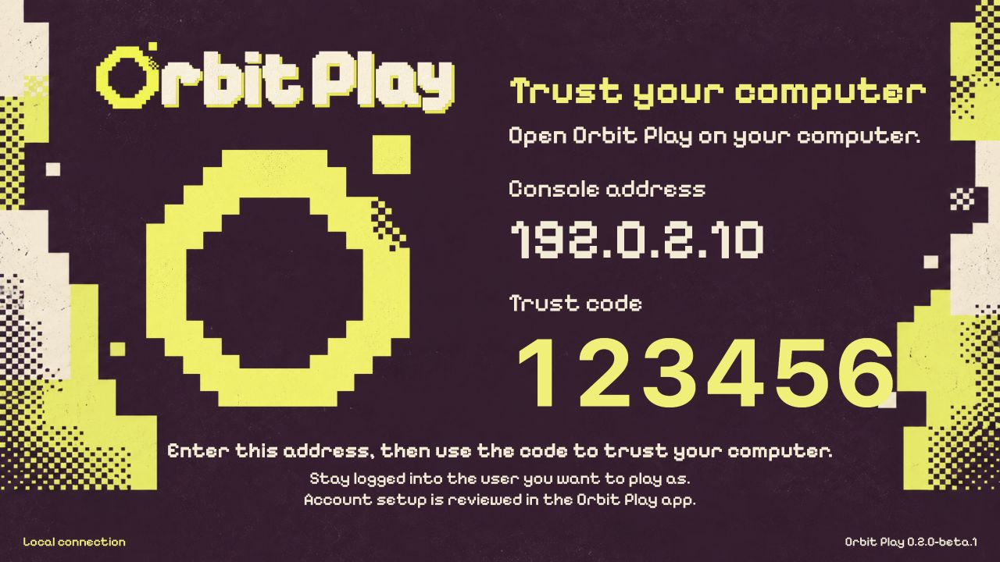

# Start the PS5 helper

[All guides](../README.md#guides) · [First connection](getting-started.md) · [Troubleshooting](troubleshooting.md)

The helper shows the code used to trust your computer and handles the Remote
Play PIN automatically, so you don't need a separate PIN tool. Keep it running
while you use Orbit Play. **The desktop app includes the helper and can start it
for you.** You do not need a separate ELF download.

The tested PS5 setup is **firmware 13.60, Relapse and Payload Manager v0.5.2**.
See [beta status](../README.md#beta-status) for the limits on other firmware.

## Start it from the computer app

1. Turn on the PS5, load your jailbreak and log into the profile you want to play as.
2. Open Payload Manager on the PS5, or enable an ELF loader.
3. In the computer app's **Console setup**, enter the PS5's IP address and choose
   **Start helper on PS5**.

Orbit Play tries Payload Manager on port 8084 first. If it is unavailable, it
uses an ELF loader on port 9021. If yours use other ports, change them under **Profile & connection
options**. If an Orbit Play helper is already running, the app uses it instead
of starting another; if it is a different version, stop it first (see
[restarts](#the-media-icon-and-restarts)).

## Optional: get the ELF

You only need the ELF to run the helper yourself. Choose either copy from the
same version:

- **In the app:** choose **Get PS5 helper**. Save `orbit-play.elf`, then upload
  or send it through your payload loader.
- **From a release:** download `orbit-play-<version>-ps5.elf` and
  [check its checksum](installation.md#check-your-downloads).

## Optional: run the ELF yourself

1. Turn on the PS5 and log into the profile you want to play as.
2. Load your jailbreak, then run the Orbit Play ELF with Payload Manager or
   your compatible ELF loader.
3. Read the helper's console address and six-digit trust code. Open the
   **Orbit Play** icon in the **Media** row if you need to see the screen again.
4. In the computer app, choose **Console setup** and follow
   [the connection walkthrough](getting-started.md#3-find-your-console).



*Example address and code. Use the values shown on your own PS5.*

## Your codes

| Code | What you do |
| --- | --- |
| Six-digit **Orbit Play trust code** | Enter it in the computer app to trust that computer. Use the new code after the helper restarts. |
| PS5 **Remote Play PIN** | Nothing to copy. Orbit Play exchanges it automatically when you choose **Pair locally**. |
| **Away code** | Only to [set up from anywhere](play-away-from-home.md#set-up-from-anywhere): on the PS5's Orbit Play page, choose **Play away from home → Get a code**. Enter it with the trust code under **Not at home? Set up from anywhere**. It works once, for 30 minutes. |

None of these codes is a PSN password. Orbit Play does not ask you to sign into PSN in
the app.

## The Media icon and restarts

The Media icon opens a page served by the running helper. It **does not start the
payload**. Its page also has **Play away from home → Get a code**. After a PS5 reboot, load the jailbreak, open Payload Manager or enable
your ELF loader, then choose **Start helper on PS5** in the desktop app.

Replacing or deleting the ELF does not stop an older copy already running in
memory. If the app reports the wrong helper version, or the PS5 says the helper's port is
already in use, follow [the update steps](installation.md#update-the-app-and-helper-together).

## Use it on your local network

Keep the PS5 and computer on the same trusted network. The helper's control
channel uses local HTTP on **TCP port 34179**. In the computer app, enter just the
PS5's IP address, without the port. Do not forward the helper port to the internet.

Guest Wi-Fi, client isolation or a VPN can prevent the devices from reaching
each other. If the PS5 has no address, connect it to your local network and run
the helper again. Orbit Play does not wake a PS5 from Rest Mode in this beta.

To play away from home, don't forward ports: the helper includes Orbit Link, and
**Play away from home** in the app connects your computer and PS5 directly and
encrypted. See [play away from home](play-away-from-home.md). Its setup is saved
on the PS5 in `/data/orbit-play/link`, and Orbit Link starts with the helper.

## Add the Payload Manager source

This source is optional: use it if you prefer to download and run the helper
through Payload Manager yourself. The [Payload Manager source](../payloads.json)
includes the **0.5.0** helper. Starting the included helper from the desktop app
does not require adding a source.

1. Copy the source URL below.
2. In Payload Manager, open **Settings → Manage Sources → Add Source**.
3. Paste that URL, choose Orbit Play and download the helper.
4. Run it and use the computer app from the same release.

```text
https://raw.githubusercontent.com/saawant12/orbit-play-ps5/main/payloads.json
```

**Next:** [Trust, pair and play](getting-started.md#3-find-your-console) ·
[Helper problems](troubleshooting.md#the-helper-icon-does-not-open)
