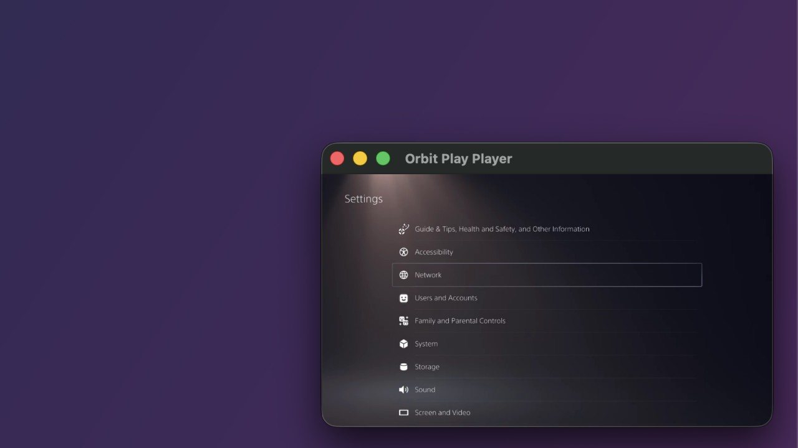
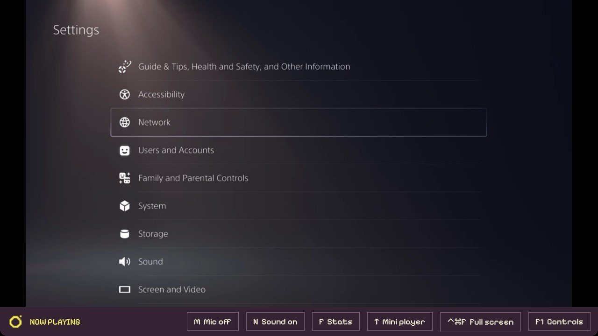
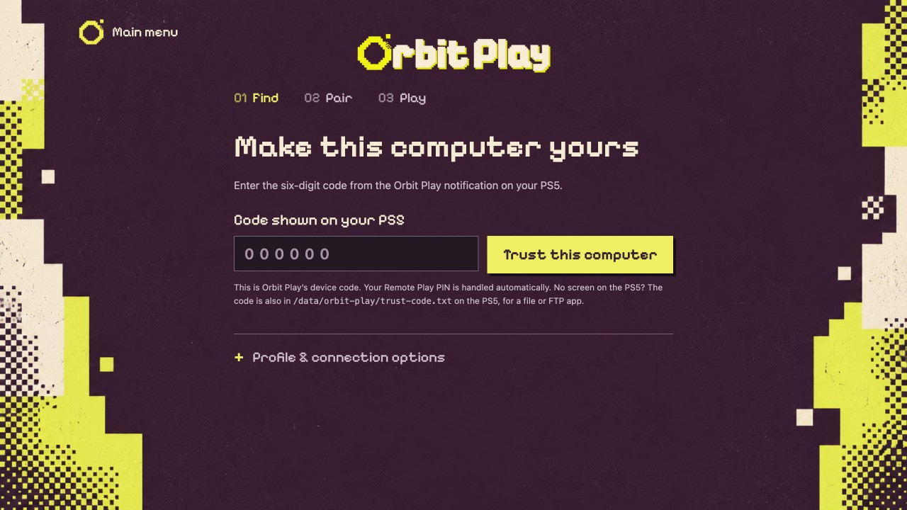
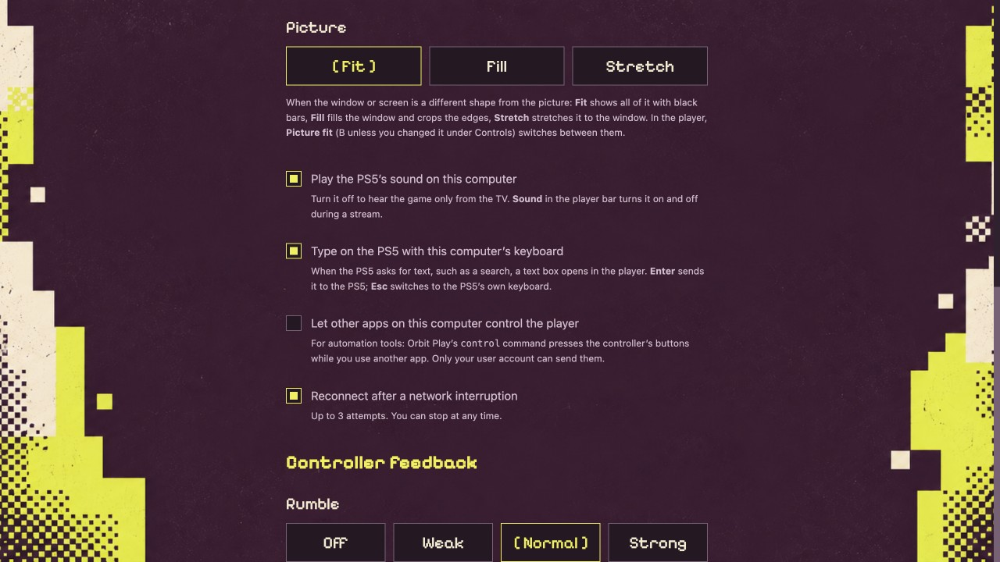

# Orbit Play 0.7.0 (Beta)

Orbit Play is a free, open-source Remote Play app for jailbroken PS5s on Mac, Windows and Linux. Stream without a PSN sign-in, including from offline PS5 accounts that have never been linked to PSN. Account setup, the account ID, the Remote Play PIN, pairing and streaming all happen in one desktop app, so there's no base64 account-ID conversion, PIN tool or separate activation payload to run.

**A couple of improvements and fixes.**

- **Mini player.** Press **T** or choose **Mini player** in the player bar for a small player in the corner of the screen that stays above your other apps. On a Mac it also follows you to other desktops. Press **T** again to go back to the full window.
- **No screen on your PS5?** The helper also saves the six-digit trust code on the PS5, in `/data/orbit-play/trust-code.txt`. Read it with a file or FTP app on the PS5, such as **Files** in Orbit Store (**Internal storage → orbit-play**), and enter it in Orbit Play as usual.
- **Control the player from other apps.** For automation tools and AI agents on Mac and Linux: turn on **Let other apps on this computer control the player** under **Playback**, and scripts or an AI agent can press the controller's buttons and move the sticks while you use another app, for example to let an agent find its way around the PS5 or test a game for you. Only your user account can send them. A command-line tool is included for this: run Orbit Play with `control`, such as `OrbitPlay control press cross`, from a terminal, a script or an agent. [How to use it](https://github.com/saawant12/orbit-play-ps5/blob/v0.7.0/guides/player-control.md).
- **Other improvements and bug fixes.**

**Orbit stays free.** [Orbit Store](https://github.com/saawant12/orbit-store-ps5), [Orbit Zero](https://github.com/saawant12/orbit-store-ps5#orbit-zero-for-mac-windows-and-linux), [Orbit Play](https://github.com/saawant12/orbit-play-ps5) and our upcoming apps are free and will stay free.

I’ve been building Orbit in my own time and covering the costs of AI tools, test consoles, hardware and servers. If you’d like to help, you can support Orbit on [GitHub Sponsors](https://github.com/sponsors/saawant12) or [Buy Me a Coffee](https://buymeacoffee.com/saawant12). It’s entirely optional.

  
  

  
  

[Install on Mac, Windows or Linux](https://github.com/saawant12/orbit-play-ps5/blob/v0.7.0/guides/installation.md) · [Connect your PS5](https://github.com/saawant12/orbit-play-ps5/blob/v0.7.0/guides/getting-started.md) · [Playback and controls](https://github.com/saawant12/orbit-play-ps5/blob/v0.7.0/guides/playback-and-controls.md) · [FAQ](https://orbitplay.dev/faq/)

## Install on your computer

Choose the package for your computer from **Assets**: the macOS DMG for Apple Silicon Macs, the Windows x64 ZIP, or the Linux x64 or arm64 AppImage. Windows 11 on ARM uses the x64 ZIP. See the installation guide above for requirements and first-launch permissions.

**You only need to download the desktop app.** It includes the player and the **0.7.0 PS5 helper**, and can start the helper for you. The standalone `orbit-play-0.7.0-ps5.elf` in Assets is optional, for those who prefer to load it themselves.

## Start on your PS5

Load your jailbreak, open Payload Manager or enable an ELF loader, and stay logged into the PS5 profile you want to use. In Orbit Play, enter the console's IP address and choose **Start helper on PS5**. Enter the six-digit trust code shown on the PS5, then pair and play. If the profile needs it, Orbit Play offers account setup before pairing.

Orbit Play has been tested on PS5 firmware 13.60 with Payload Manager v0.5.2 and v0.6.3. Other firmware may work but is untested.

## Update from an earlier version

From 0.6.0, choose **Update now** at the bottom of the main menu. Then open **Console setup**, choose **Replace helper on PS5** and enter the new trust code. Your saved pairings, playback settings, controls and play away from home remain.

From an earlier version, stop your stream, quit Orbit Play and replace the computer app: on a Mac, replace it in Applications; on Windows, extract the new ZIP into a fresh folder; on Linux, use the new AppImage. Open **Console setup** and choose **Find console**. When it reports the earlier helper, choose **Replace helper on PS5**, then enter the new trust code. If Payload Manager isn't running on the PS5, stop the old helper yourself, or fully restart the PS5 and reload the jailbreak, then choose **Start helper on PS5**.

For account setup, we recommend a separate PS5 profile with no saves: creating a local account ID may make existing saves inaccessible. [Account setup and save risks](https://github.com/saawant12/orbit-play-ps5/blob/v0.7.0/guides/account-setup.md).

  
  

