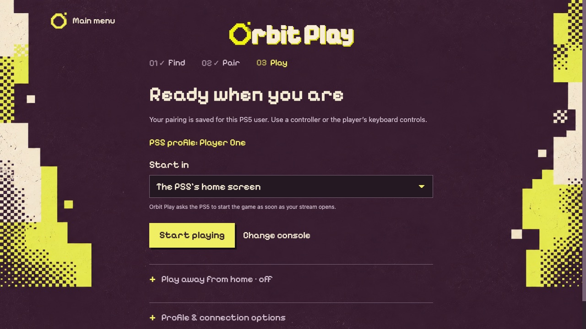
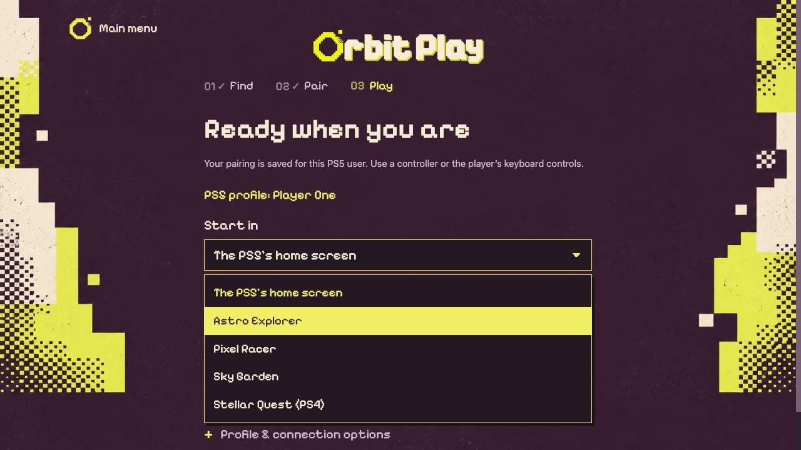
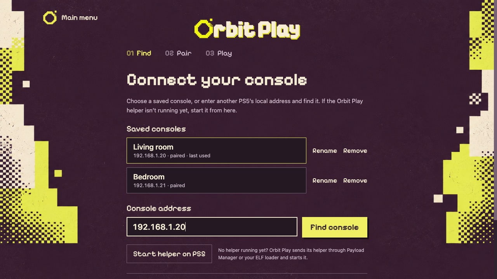
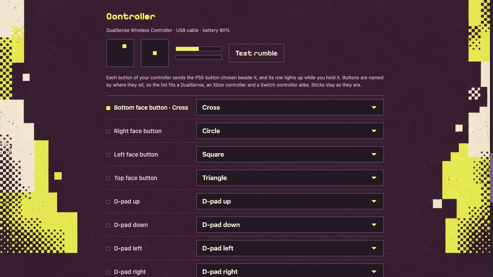

# Orbit Play 0.8.0 (Beta)

Orbit Play is a free, open-source Remote Play app for jailbroken PS5s on Mac, Windows and Linux. Stream without a PSN sign-in, including from offline PS5 accounts that have never been linked to PSN. Account setup, the account ID, the Remote Play PIN, pairing and streaming all happen in one desktop app, so there's no base64 account-ID conversion, PIN tool or separate activation payload to run.

**New features and fixes.**

- **Your language, and a tidier play screen.** Orbit Play and the PS5 helper's pages now come in 25 more languages, the same as Orbit Store, including Arabic laid out right to left. Choose one under the new **Settings** on the main menu. The translations were made by machine, so some wording may be off. The play screen also shows fewer options at once: **Play away from home** folds into one line.
- **Several PS5s, set up once.** Every PS5 you connect to is saved under **Console setup**: pick one, rename it or remove it, with no second copy of Orbit Play. Enter the trust code once and the PS5 remembers this computer, even after the helper or the PS5 restarts. The Orbit Play page on the PS5 lists **Trusted computers** and can forget them all.
- **The helper starts by itself.** Turn on **Start the helper by itself on the PS5** under **Console setup → Profile & connection options**, and Payload Manager starts Orbit Play's helper each time the jailbreak loads. There's nothing to send after a PS5 restart, and the rest of your Autoload list stays as it is.
- **Start in a game, or go straight in.** Choose a game under **Start in** and Orbit Play starts it as soon as your stream opens. **Turn the PS5 off when I stop playing**, under **Playback**, turns the PS5 off after you close the player. Start Orbit Play with `--play` to connect to your last PS5 and open the stream with no clicks, for a desktop shortcut or a Steam Deck library entry. Add a PS5's name to choose one, or `--game` and a title ID to start in a game.
- **Check and change your controller.** **Controls → Controller** shows your controller live (sticks, triggers and buttons) and lets you choose what each button sends to the PS5. Buttons are named by where they sit, so the same list fits a DualSense, an Xbox controller and a Switch controller. **Test rumble** checks the rumble.
- **Windows setup program and player control.** Install Orbit Play on Windows with `OrbitPlay-0.8.0-windows-x64-setup.exe`: no administrator rights needed, with a Start menu entry and an entry under Installed apps. Orbit Play still updates itself, and the ZIP is still available. **Let other apps on this computer control the player** now works on Windows too.
- **Other firmware.** On firmware other than 13.60, the helper now turns on the profile's Remote Play permission for each pairing and stream, and puts it back afterwards. Some profiles were refused without it. This is untested on other firmware.
- **Better diagnostics.** **Export diagnostics** now includes earlier sessions and the PS5 helper's own log, still without addresses, names, account IDs or keys.
- **Other improvements and bug fixes.**

**Orbit stays free.** [Orbit Store](https://github.com/saawant12/orbit-store-ps5), [Orbit Zero](https://github.com/saawant12/orbit-store-ps5#orbit-zero-for-mac-windows-and-linux), [Orbit Play](https://github.com/saawant12/orbit-play-ps5) and our upcoming apps are free and will stay free.

I’ve been building Orbit in my own time and covering the costs of AI tools, test consoles, hardware and servers. If you’d like to help, you can [support Orbit via crypto](https://github.com/saawant12/orbit-play-ps5/issues/6#user-content-support-with-crypto). It’s entirely optional.

  
  

  
  

[Install on Mac, Windows or Linux](https://github.com/saawant12/orbit-play-ps5/blob/v0.8.0/guides/installation.md) · [Connect your PS5](https://github.com/saawant12/orbit-play-ps5/blob/v0.8.0/guides/getting-started.md) · [Playback and controls](https://github.com/saawant12/orbit-play-ps5/blob/v0.8.0/guides/playback-and-controls.md) · [FAQ](https://orbitplay.dev/faq/)

## Install on your computer

Choose the package for your computer from **Assets**: the macOS DMG for Apple Silicon Macs, the Windows x64 setup program or ZIP, or the Linux x64 or arm64 AppImage. Windows 11 on ARM uses the x64 files. See the installation guide above for requirements and first-launch permissions.

**You only need to download the desktop app.** It includes the player and the **0.8.0 PS5 helper**, and can start the helper for you. The standalone `orbit-play-0.8.0-ps5.elf` in Assets is optional, for those who prefer to load it themselves.

## Start on your PS5

Load your jailbreak, open Payload Manager or enable an ELF loader, and stay logged into the PS5 profile you want to use. In Orbit Play, enter the console's IP address and choose **Start helper on PS5**. Enter the six-digit trust code shown on the PS5, then pair and play. If the profile needs it, Orbit Play offers account setup before pairing.

Orbit Play has been tested on PS5 firmware 13.60 with Payload Manager v0.5.2 and v0.6.3. Other firmware may work but is untested.

## Update from an earlier version

From 0.6.0 or later, choose **Update now** at the bottom of the main menu. Then open **Console setup**, choose **Replace helper on PS5** and enter the new trust code. From then on, the PS5 remembers this computer. Your saved pairings, playback settings, controls and play away from home remain.

From an earlier version, stop your stream, quit Orbit Play and replace the computer app: on a Mac, replace it in Applications; on Windows, run the setup program or extract the new ZIP into a fresh folder; on Linux, use the new AppImage. Open **Console setup** and choose **Find console**. When it reports the earlier helper, choose **Replace helper on PS5**, then enter the new trust code. If Payload Manager isn't running on the PS5, stop the old helper yourself, or fully restart the PS5 and reload the jailbreak, then choose **Start helper on PS5**.

On Windows, you can move from the ZIP to the setup program at any time: run it, and your pairings and settings carry over. Ran a second copy of Orbit Play for a second PS5? Connect to that PS5 from your main copy instead, and it's saved beside the first.

For account setup, we recommend a separate PS5 profile with no saves: creating a local account ID may make existing saves inaccessible. [Account setup and save risks](https://github.com/saawant12/orbit-play-ps5/blob/v0.8.0/guides/account-setup.md).

  

